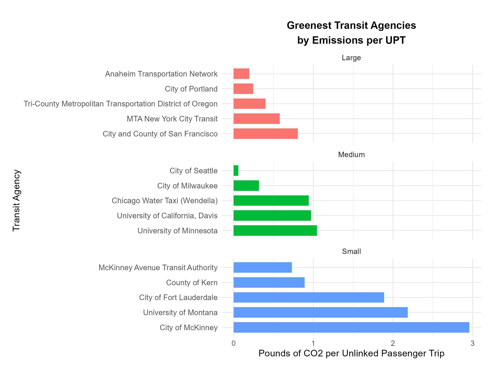
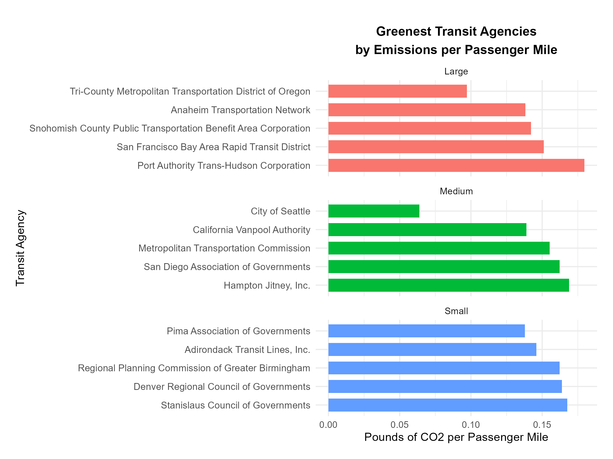
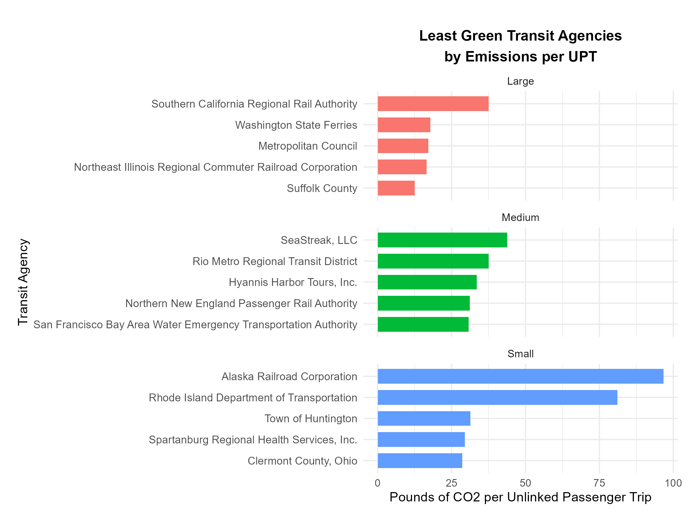
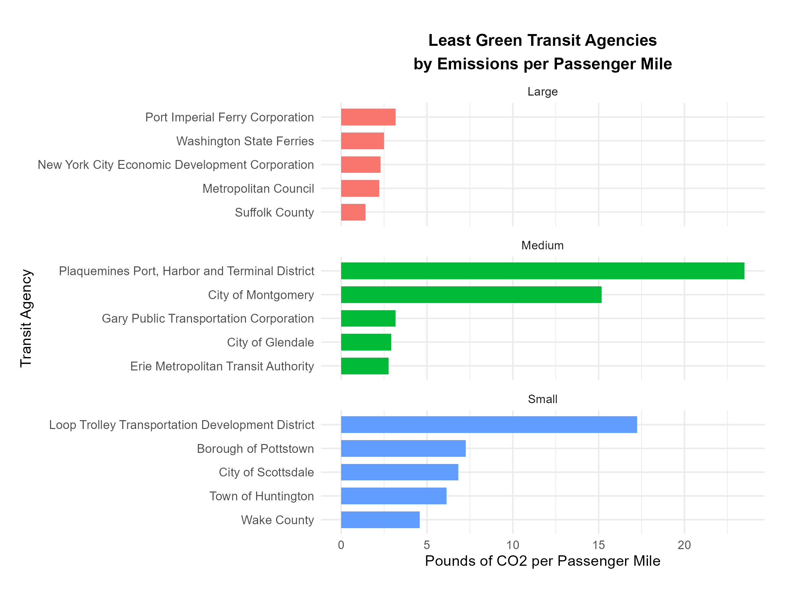
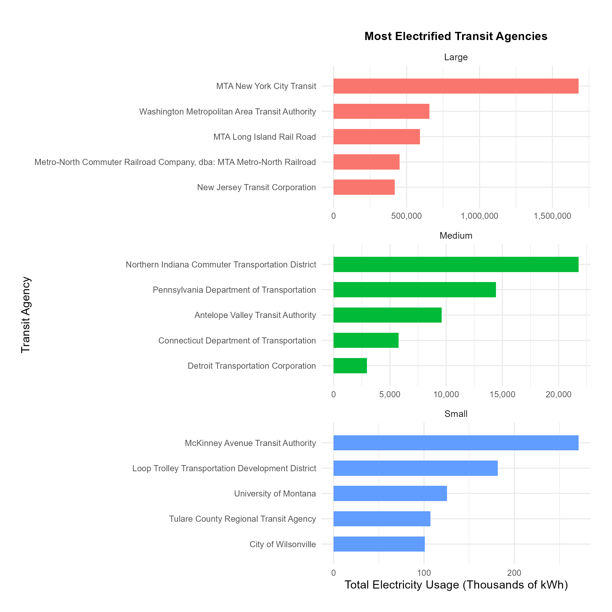

# Mini Project 02: Identifying Environmentally Responsible US Public Transit Systems

## Data Acquisition
### Task 1a, 1b, & 1c  

```{r}
# Any additional package to load

library(ggplot2)
library(dplyr)
library(tidytext)
```

```{r}
# Data Acquisition: State Electricity Profile 

library(tidyverse)
library(stringr)
library(httr2)
library(rvest)

get_eia_sep <- function(state, abbr){
  library(tidyverse)
  library(stringr)
  library(httr2)
  library(rvest)
  library(fs)
  
  state_formatted <- str_to_lower(state) |> str_replace_all("\\s", "")
  
  dir_name <- fs::path("data", "mp02")
  file_name <- fs::path(dir_name, state_formatted)
  
  fs::dir_create(dir_name, recurse=TRUE)
  
  if(!fs::file_exists(file_name)){
    BASE_URL <- "https://www.eia.gov"
    RESPONSE <- request(BASE_URL) |> 
      req_url_path("electricity", 
                   "state", 
                   state_formatted) |>
      req_headers(
        `User-Agent` = "Mozilla/5.0 (Macintosh; Intel Mac OS X 10.15; rv:149.0) Gecko/20100101 Firefox/149.0"
      ) |>   
      req_retry(
        max_tries = 4, 
      ) |>
      req_perform(file_name)
    
    resp_check_status(RESPONSE)
  }
  
  TABLE <- read_html(file_name) |> 
    html_element("table") |> 
    html_table() |>
    mutate(Item = str_to_lower(Item))
  
  if("U.S. rank" %in% colnames(TABLE)){
    TABLE <- TABLE |> rename(Rank = `U.S. rank`)
  }
  
  CO2_MWh <- TABLE |> 
    filter(Item == "carbon dioxide (lbs/mwh)") |>
    pull(Value) |> 
    str_replace_all(",", "") |>
    as.numeric()
  
  PRIMARY <- TABLE |> 
    filter(Item == "primary energy source") |> 
    pull(Rank)
  
  RATE <- TABLE |>
    filter(Item == "average retail price (cents/kwh)") |>
    pull(Value) |>
    as.numeric()
  
  GENERATION_MWh <- TABLE |>
    filter(Item == "net generation (megawatthours)") |>
    pull(Value) |>
    str_replace_all(",", "") |>
    as.numeric()
  
  data.frame(CO2_MWh               = CO2_MWh, 
             primary_source        = PRIMARY,
             electricity_price_MWh = RATE * 10, # / 100 cents to dollars &
             # * 1000 kWh to MWH 
             generation_MWh        = GENERATION_MWh, 
             state                 = state, 
             abbreviation          = abbr
  )
}

EIA_SEP_REPORT <- map2(state.name, state.abb, get_eia_sep) |> list_rbind()
```

```{r}
# Data Acquisition: Energy Consumption

load_ntd_energy <- function(){
  library(readxl)
  library(httr2)
  library(tidyverse)
  library(fs)
  
  # Create 'data/mp02' directory if not already present
  DATA_DIR <- fs::path("data", "mp02")
  fs::dir_create(DATA_DIR, recurse=TRUE)

  NTD_ENERGY_FILE <- fs::path(DATA_DIR, "2025_ntd_energy.xlsx")

  if(!fs::file_exists(NTD_ENERGY_FILE)){
    library(httr2)
  
    request("https://www.transit.dot.gov/") |>
      req_url_path("sites",
                   "fta.dot.gov",
                   "files",
                   "2026-09",
                   "2025 Energy Consumption_260806.xlsx") |> 
      req_headers(
        `User-Agent` = "Mozilla/5.0 (Macintosh; Intel Mac OS X 10.15; rv:149.0) Gecko/20100101 Firefox/149.0") |> 
      req_perform(NTD_ENERGY_FILE)
  }
  
  if(file.info(NTD_ENERGY_FILE)$size < 1e4){
        cat("I was unable to download the NTD Energy File. Please try again.\n")
        stop("Download failed. Please delete the corrupted file by running `unlink('data/mp02/2025_ntd_energy.xlsx')` and try again.")
    }

  to_numeric_fill_0 <- function(x){
    x <- if_else(x == "-", NA, x)
    replace_na(as.numeric(x), 0)
  }

  read_excel(NTD_ENERGY_FILE) |> 
    select(-c(`Reporter Type`, 
              `Reporting Module`, 
              `Gallons of Other Fuel`, 
              `Other Fuel Description`)) |>
    mutate(across(-c(`Agency Name`, 
                     `Mode`,
                     `TOS`), 
                  to_numeric_fill_0)) |>
    group_by(`NTD ID`, `Mode`, `Agency Name`) |>
    summarize(across(where(is.numeric), sum), 
              .groups = "keep") |>
    mutate(ENERGY = sum(c_across(c(where(is.numeric))))) |>
    filter(ENERGY > 0) |>
    select(-ENERGY) |>
    ungroup()
}

NTD_ENERGY <- load_ntd_energy()
```

We received a warning when obtaining the second data set. The warning is saying that at least one of our values could not be converted into a number. The following code is to inspect it. We found the warning is regarding the mutate function that we are using. The column "Bio-Diesel Description" in our modified and raw data stood out the most being that the original values are strings, and the modified values are numerical with zeros. This column is the likely culprit. The other columns (with non numeric text values) were excluded during the data modification process, thus can not be the reason for the warning.

```{r}
dplyr::last_dplyr_warnings()
glimpse(NTD_ENERGY)
RAW_NTD_ENERGY <- readxl::read_excel("data/mp02/2025_ntd_energy.xlsx")
glimpse(RAW_NTD_ENERGY)
count(RAW_NTD_ENERGY, `Bio-Diesel Description`, sort = TRUE)
purrr::map(
  RAW_NTD_ENERGY |>
    dplyr::select(-c(`Agency Name`, Mode, TOS)),
  \(x) unique(x[!is.na(x) & is.na(suppressWarnings(as.numeric(x)))])
)
```

```{r}
# Data Acquisition: Transit Service Provided

load_ntd_service <- function(){
  library(httr2)
  library(tidyverse)
  library(fs)
  
  # Create 'data/mp02' directory if not already present
  DATA_DIR <- fs::path("data", "mp02")
  fs::dir_create(DATA_DIR, recurse=TRUE)

  NTD_SERVICE_FILE <- fs::path(DATA_DIR, "2025_ntd_service.csv")

  if(!fs::file_exists(NTD_SERVICE_FILE)){
    library(httr2)
  
    request("https://data.transportation.gov/resource/4fir-qbim.csv") |>
      req_url_query(`$query`=paste(
        "SELECT  `_5_digit_ntd_id` AS `NTD_ID`", 
        "`max_agency` AS `AGENCY`",
        "`max_reporter_type` AS `reporter_type`",
        "`max_organization_type` AS `organization_type`",
        "`max_city` AS `city`",
        "`max_state` AS `state`",
        "`mode`",
        "`type_of_service`",
        "`max_primary_uza_code` as `uza_code`",
        "`max_primary_uza_name` as `uza_name`",
        "`max_primary_uza_area_sq_miles` as `uza_sq_miles`",
        "`max_primary_uza_population` as `uza_population`",
        "`max_service_area_sq_miles` as `service_area_sq_miles`",
        "`max_service_area_population` as `service_area_population`",
        "`questionable_record` as `flagged_likely_inaccurate`",
        "`sum_unlinked_passenger_trips_upt` as `total_upt`",
        "`sum_passenger_miles` WHERE caseless_one_of(`report_year`, '2025') limit 50000", 
        sep=",")) |>
      req_headers(
        `User-Agent` = "Mozilla/5.0 (Macintosh; Intel Mac OS X 10.15; rv:149.0) Gecko/20100101 Firefox/149.0") |> 
      req_perform(NTD_SERVICE_FILE)
  }
  
  if(file.info(NTD_SERVICE_FILE)$size < 1e4){
        cat("I was unable to download the NTD Service File. Please try again.\n")
        stop("Download failed. Please delete the corrupted file by running `unlink('data/mp02/2025_ntd_service.xlsx')` and try again.")
    }

  read_csv(NTD_SERVICE_FILE) |>
    mutate(flagged_likely_inaccurate = !is.na(flagged_likely_inaccurate))
}

NTD_SERVICE <- load_ntd_service()
```

```{r}
# Inspection of data: The following code was done to inspect the data and get an idea of what type of values we will be working with.
# "dim" was used to get an idea of how many rows and columns we are dealing with.
# "glimpse" was used to see if the columns have the expected data types that we will need.
# "summary" was used to show some basic statistics.
# "skimr:skim was used to see how the data was distributed
# "slice_sample(n=5)" was used to check for responsibility from a random sample of five data points 

dim(EIA_SEP_REPORT)
glimpse(EIA_SEP_REPORT)
summary(EIA_SEP_REPORT)
skimr::skim(EIA_SEP_REPORT)
EIA_SEP_REPORT |> dplyr::slice_sample(n = 5)

dim(NTD_ENERGY)
glimpse(NTD_ENERGY)
summary(NTD_ENERGY)
skimr::skim(NTD_ENERGY)
NTD_ENERGY |> dplyr::slice_sample(n = 5)

dim(NTD_SERVICE)
glimpse(NTD_SERVICE)
summary(NTD_SERVICE)
skimr::skim(NTD_SERVICE)
NTD_SERVICE |> dplyr::slice_sample(n = 5)
```

## Data Cleaning and Preparation
### Task 2

#### **Note that we did not modify the column name into tidy format for the following "NTD_ENERGY_Modified" dataset like we normally would do. We did this so we can easily read these columns later when we need to match them with the fuel names in the ETA website.**

```{r}
# First we need to find the distinct codes for the "mode" column that appears in our NTD_ENERGY and NTD_SERVICE datasets.

NTD_ENERGY |>
  dplyr::distinct(Mode) |>
  dplyr::arrange(Mode)

NTD_SERVICE |>
  dplyr::distinct(mode) |>
  dplyr::arrange(mode)
```
  
Now that we know what coding to modify under the "mode" column for both datasets, we will modify those values. Instead of altering the original modified datasets, we will create two new ones that will have those modified values, and will use those going forward. This will ensure that if anything goes wrong, we still have our original modified data and won't have to re run any code regarding data acquisition or initial modification. 

```{r}
NTD_ENERGY_Modified <- NTD_ENERGY |>
  mutate(Mode = recode_values(Mode,
    "AR" ~ "Alaska Railroad",
    "CB" ~ "Commuter Bus",
    "CC" ~ "Cable Car",
    "CR" ~ "Commuter Rail",
    "DR" ~ "Demand Response",
    "FB" ~ "Ferryboat",
    "HR" ~ "Heavy Rail",
    "IP" ~ "Inclined Plane",
    "LR" ~ "Light Rail",
    "MB" ~ "Bus",
    "MG" ~ "Monorail and Automated Guideway modes",
    "RB" ~ "Bus Rapid Transit",
    "SR" ~ "Streetcar Rail",
    "TB" ~ "Trolleybus",
    "TR" ~ "Aerial Tramway",
    "VP" ~ "Vanpool",
    "YR" ~ "Hybrid Rail",
    default = "Unknown"
  ))

NTD_SERVICE_Modified <- NTD_SERVICE |>
  mutate(mode = recode_values(mode,
    "AR" ~ "Alaska Railroad",
    "CB" ~ "Commuter Bus",
    "CC" ~ "Cable Car",
    "CR" ~ "Commuter Rail",
    "DR" ~ "Demand Response",
    "FB" ~ "Ferryboat",
    "HR" ~ "Heavy Rail",
    "IP" ~ "Inclined Plane",
    "LR" ~ "Light Rail",
    "MB" ~ "Bus",
    "MG" ~ "Monorail and Automated Guideway modes",
    "RB" ~ "Bus Rapid Transit",
    "SR" ~ "Streetcar Rail",
    "TB" ~ "Trolleybus",
    "TR" ~ "Aerial Tramway",
    "VP" ~ "Vanpool",
    "YR" ~ "Hybrid Rail",
    default = "Unknown"
  ))

# Following code is to check if the re-coding worked  
NTD_ENERGY_Modified |> dplyr::distinct(Mode) |> dplyr::arrange(Mode)
NTD_SERVICE_Modified |> dplyr::distinct(mode) |> dplyr::arrange(mode)
```

## Data Integration and Initial Exploration

### Task 3a 3b and 3c 

#### Which 5 states have the most expensive retail electricity? (Graph answer)

```{r}
# Sorts the data so we have our top five states.

EIA_TOP_5_PRICES <- EIA_SEP_REPORT |>
  arrange(desc(electricity_price_MWh)) |>
  slice_head(n = 5)

EIA_TOP_5_PRICE_STATES <- EIA_TOP_5_PRICES |>
  pull(state)
  
# Displays the data in a graph for us to view it easily.

EIA_TOP_5_PRICES |>
  ggplot(aes(x = reorder(state, electricity_price_MWh),
             y = electricity_price_MWh)) +
  geom_col() +
  coord_flip() +
  labs(
    title = "To 5 States with the Most Expensive Retail Electricity",
    x = "State",
    y = "Electricity Price (Dollar per MWh)"
  ) +
  theme_minimal()
```  

From the above graph we see that `r EIA_TOP_5_PRICE_STATES[1]` is the leading state with the most expensive retail electricity, followed by `r EIA_TOP_5_PRICE_STATES[2]`, `r EIA_TOP_5_PRICE_STATES[3]`, `r EIA_TOP_5_PRICE_STATES[4]`, and `r EIA_TOP_5_PRICE_STATES[5]`. Taking a closer look, we see that the 4 states that follow are relatively close to each other regarding their electricity price, while Hawaii is much further out in the 300s range. This could be due to `r EIA_TOP_5_PRICE_STATES[1]` having Petroleum as its primary energy source while the other states has Natural Gas.

#### Which 5 states have the ‘dirtiest’ electricity mix? (Table answer)

```{r}
library(gt)

# Sort the data so we have the top 5 dirtiest states.

EIA_DIRTIEST_5 <- EIA_SEP_REPORT |>
  arrange(desc(CO2_MWh)) |>
  slice_head(n = 5) |>
  select(state, primary_source, CO2_MWh)

EIA_DIRTIEST_STATES <- EIA_DIRTIEST_5 |>
  pull(state)

# Creates a table for us so we can view the ranking easier

EIA_DIRTIEST_5 |>
  gt() |>
  cols_label(
    state = "State",
    primary_source = "Primary Electricity Source",
    CO2_MWh = "CO2 Emissions (Ibs per MWh)"
  ) |>
  tab_header(
    title = "Five States with the Dirtiest Electricity Mix",
    subtitle = "Ranked by pounds CO2 emitted per MWh"
  ) |>
  fmt_number(
    columns = CO2_MWh,
    decimals = 1,
    use_seps = TRUE
  ) |>
  opt_row_striping() |>
  tab_options(
    row.striping.background_color = "#E8E8E8"
  )
```

As can be seen from the table above, `r EIA_DIRTIEST_STATES[1]` is the most "dirtiest" state while `r EIA_DIRTIEST_STATES[2]`, `r EIA_DIRTIEST_STATES[3]`, `r EIA_DIRTIEST_STATES[4]`, and `r EIA_DIRTIEST_STATES[5]`, follows behind. One interesting observation is that the majority of these states uses Coal as their primary electricity source. This could potentially be one of the factor to why they are producing relatively more CO2 emissions compared to other states.

#### On average, how many pounds of CO2 are emitted per MWh of electricity produced in the U.S.? (Note that we will need use a suitably weighted average here.) (Inline answer)

```{r}
# Here we calculate the weighted average. 
# The weight is based on the total amount of electricity that each state generates.

EIA_US_CO2_AVERAGE <- EIA_SEP_REPORT |>
  summarize(
    weighted_CO2_average = weighted.mean(
      CO2_MWh,
      generation_MWh
    )
  )

EIA_US_CO2_AVERAGE
```

On average `r EIA_US_CO2_AVERAGE` pounds of CO2 is produced in the United States. This value can give us an idea of how "clean" or "dirty" other states are when compared to the average.

#### What are the three rarest primary energy sources in the US? What is the associated cost of electricity associated with each source and in what states are they used? (Table answer)

```{r}
# The following code help us count how many times each energy source appears in the dataset.

EIA_SOURCE_COUNTS <- EIA_SEP_REPORT |>
  count(primary_source, name = "number_of_states") |>
  arrange(number_of_states)

EIA_SOURCE_COUNTS

# Here we are identifying the top 3 rarest sources

EIA_RAREST_SOURCES <- EIA_SOURCE_COUNTS |>
  slice_min(number_of_states, n = 3, with_ties = TRUE)

EIA_RAREST_SOURCES

EIA_RAREST_SOURCE_NAMES <- EIA_RAREST_SOURCES |>
  pull(primary_source)

# We next identify the states and electricity prices associated with our rare energy sources.

EIA_RAREST_SOURCE_DETAILS <- EIA_SEP_REPORT |>
  inner_join(EIA_RAREST_SOURCES, by = "primary_source") |>
  select(
    primary_source,
    number_of_states,
    state,
    electricity_price_MWh
  ) |>
  arrange(number_of_states, primary_source, state)

EIA_RAREST_SOURCE_DETAILS

# Finally we create the table to help us visualize the results

library(gt)

EIA_RAREST_SOURCE_DETAILS |>
  gt() |>
  cols_label(
    primary_source = "Primary Energy Source",
    number_of_states = "Number of States",
    state = "State",
    electricity_price_MWh = "Electricity Price ($ per MWh)"
  ) |>
  tab_header(
    title = "Three Rarest Primary Electricity Sources",
    subtitle = "Associated states and retail electricity prices"
  ) |>
  fmt_number(
    columns = electricity_price_MWh,
    decimals = 2,
    use_seps = TRUE
  ) |>
  opt_row_striping() |>
  tab_options(
    row.striping.background_color = "#E8E8E8"
  )
```

From the table above we see that is the rarest energy source among the whole dataset is `r EIA_RAREST_SOURCE_NAMES[1]` with only one state using it. Meanwhile, the two other rarest sources `r EIA_RAREST_SOURCE_NAMES[2]` and `r EIA_RAREST_SOURCE_NAMES[3]` each have 4 states that uses it as a primary energy source. This table can be particularly valuable when we want to identify states that uses more of a "unique" energy source and how they compare to other states that uses something more common. 

#### How many times cleaner is NY’s energy mix than that of Texas? (Inline answer)

```{r}
# We first obtain the CO2 values for New York and Texas

EIA_NY_TEXAS <- EIA_SEP_REPORT |>
  filter(state %in% c("New York", "Texas")) |>
  select(state, CO2_MWh)

EIA_NY_TEXAS

# We now compare the two values

EIA_NY_CLEANER <- EIA_NY_TEXAS |>
  summarize(
    times_cleaner = CO2_MWh[state == "Texas"] /
      CO2_MWh[state == "New York"]
  )

EIA_NY_CLEANER

# For our Inline value
EIA_NY_CLEANER_ROUNDED <- round(EIA_NY_CLEANER$times_cleaner, 2)
```

Based on our above results, Texas produces `r EIA_NY_CLEANER_ROUNDED` times as much CO2 (per MWh) as New York. In other words, New York is `r EIA_NY_CLEANER_ROUNDED` times cleaner than Texas. It's interesting to see this because both states uses Natural Gas as their primary energy source. This leads to questions of what aspects of NY or what practices are being done that makes this state cleaner.


#### What is the least commonly used fuel source for US public transit? (Inline answer)

```{r}
# For each fuel source we want to count the number of public transit agencies using it.
# We use pivot_longer() to transform our multiple columns of energy source into two columns. 
# One column with all the sources, and the other column with the amount of use reported.
# Note we took out "Bio-Diesel Description" since that column is all 0's and is a descriptive column.
# We made sure to exclude rows where the amounts are zeros, because a if an agency reported using 0 amount of the fuel then obviously we should not consider that as a "count". 

NTD_ENERGY_SOURCE_COUNTS <- NTD_ENERGY_Modified |>
  select(-c(Mode, `Bio-Diesel Description`)) |> 
  pivot_longer(
    cols = -c(`NTD ID`, `Agency Name`),
    names_to = "energy_source",
    values_to = "amount"
  ) |>
  filter(amount > 0) |> 
  distinct(`NTD ID`, `Agency Name`, energy_source) |>
  count(energy_source, name = "agencies_using") |>
  arrange(agencies_using)

# This displays our results

NTD_ENERGY_SOURCE_COUNTS

# Gives us the least source used

NTD_LEAST_USED_SOURCE <- NTD_ENERGY_SOURCE_COUNTS |>
  slice_head(n = 1) |>
  pull(energy_source)
```

From the results above we can see that we only have 10 columns. The other two columns were excluded because they have 0 amounts reported. As can be seen from the following output.

```{r}
#The following set of codes was to inspect the missing columns to see why they were excluded.

NTD_ZERO_SOURCE_COUNTS <- NTD_ENERGY_Modified |>
  summarize(
    `Gallons of Bunker Fuel` = sum(`Gallons of Bunker Fuel`),
    `Gallons of Kerosene` = sum(`Gallons of Kerosene`)
  ) |>
  pivot_longer(
    cols = everything(),
    names_to = "energy_source",
    values_to = "amount"
  )

NTD_ZERO_SOURCE_COUNTS

NTD_ZERO_SOURCES <- NTD_ZERO_SOURCE_COUNTS |>
  pull(energy_source)
```
  
Based on both outputs if we were to consider fuels with no amounts reported, **`r NTD_ZERO_SOURCES[1]`** and  **`r NTD_ZERO_SOURCES[2]`** would be considered the least commonly used fuel source for U.S. public transit. If we are considering only reported amounts it would be **`r NTD_LEAST_USED_SOURCE`** with only 1 agency reporting it's usage. These results give us an idea of how certain rare or common some fuel sources regarding their usage.

#### Which five states has the fewest total miles traveled by public transit? (Graph answer)

```{r}
# We first group by states and aggregate the passenger miles.
# Next we arrange the states (lowest aggregate passenger miles to highest) and pick the first 5
# Note: we are excluding the U.S. territories and Washington D.C. being that those are not states

NTD_STATE_MILES <- NTD_SERVICE_Modified |>
  filter(state %in% state.abb) |>
  mutate(state = state.name[match(state, state.abb)]) |>
  group_by(state) |>
  summarize(
    total_miles = sum(sum_passenger_miles, na.rm = TRUE),
    .groups = "drop"
  ) |>
  arrange(total_miles)
  
NTD_FEWEST_STATES <- NTD_STATE_MILES |>
  slice_head(n = 5) |>
  pull(state)

NTD_STATE_MILES |>
  slice_head(n = 5)|>
   mutate(total_miles = scales::comma(total_miles))
  
# We now create a graph to help easily visualize the ranking

NTD_STATE_MILES |>
  slice_head(n = 5) |>
  ggplot(aes(
    x = reorder(state, -total_miles),
    y = total_miles
  )) +
  geom_col(fill = "steelblue", width = 0.7) +
  coord_flip() +
  scale_x_discrete(labels = c(
    WY = "Wyoming",
    SD = "South Dakota",
    NH = "New Hampshire",
    ND = "North Dakota",
    MS = "Mississippi"
  )) +
  scale_y_continuous(
    labels = scales::comma,
    expand = expansion(mult = c(0, 0.08))
  ) +
  labs(
    title = "Five States with the Fewest Public Transit Passenger Miles",
    subtitle = "Annual passenger miles reported in the 2025 NTD data",
    x = NULL,
    y = "Total Passenger Miles"
  ) +
  theme_minimal() +
  theme(
    plot.title = element_text(size = 14, face = "bold"),
    plot.subtitle = element_text(size = 10),
    axis.text = element_text(size = 11),
    axis.title.x = element_text(size = 11),
    panel.grid.major.y = element_blank()
  )
```

As can be seen from the above graph `r NTD_FEWEST_STATES[1]` have the fewest total miles traveled by public transit.
`r NTD_FEWEST_STATES[2]`, `r NTD_FEWEST_STATES[3]`, `r NTD_FEWEST_STATES[4]`, and `r NTD_FEWEST_STATES[5]` follows behind. 

Regarding this specific dataset, certain rows were flagged as "inaccurate" by the Federal Transit Administration (FTA). Just to see what our results would look like if we were to filter out those rows, we re ran the same code excluding those rows. As can be seen below, We end up producing the same results. This strengthen our finding in that the flagged rows do not alter our results. 

```{r}
NTD_STATE_MILES <- NTD_SERVICE_Modified |>
  filter(state %in% state.abb) |>
  filter(!flagged_likely_inaccurate) |>
  mutate(state = state.name[match(state, state.abb)]) |>
  group_by(state) |>
  summarize(
    total_miles = sum(sum_passenger_miles, na.rm = TRUE),
    .groups = "drop"
  ) |>
  arrange(total_miles)

NTD_FEWEST_STATES <- NTD_STATE_MILES |>
  slice_head(n = 5) |>
  pull(state)

NTD_STATE_MILES |>
  slice_head(n = 5) |>
  mutate(total_miles = scales::comma(total_miles))

NTD_STATE_MILES |>
  slice_head(n = 5) |>
  ggplot(aes(
    x = reorder(state, -total_miles),
    y = total_miles
  )) +
  geom_col(fill = "steelblue", width = 0.7) +
  coord_flip() +
  scale_y_continuous(
    labels = scales::comma,
    expand = expansion(mult = c(0, 0.08))
  ) +
  labs(
    title = "Five States with the Fewest Public Transit Passenger Miles",
    subtitle = "Annual passenger miles reported in the 2025 NTD data (excluding flagged records)",
    x = NULL,
    y = "Total Passenger Miles"
  ) +
  theme_minimal() +
  theme(
    plot.title = element_text(size = 14, face = "bold"),
    plot.subtitle = element_text(size = 10),
    axis.text = element_text(size = 11),
    axis.title.x = element_text(size = 11),
    panel.grid.major.y = element_blank()
  )
```

#### Are all states represented in this data (**NTD_SERVICE_modified**)? If no, which ones are missing? The state.name and state.abb objects built into R may be useful here, as well as the anti_join() function.(Inline answer)

```{r}
# We first set up a dataset set with 50 states.

NTD_ALL_STATES <- tibble(
  state = state.abb
)

NTD_ALL_STATES

# The following code will help us identify the missing states (if any are missing) in our NTD_SERVICE_modified dataset.

NTD_MISSING_STATES <- NTD_ALL_STATES |>
  anti_join(
    NTD_SERVICE_Modified |>
      distinct(state),
    by = "state"
  )

NTD_MISSING_STATES

#Creates our Inline value

NTD_MISSING_STATE_COUNT <- nrow(NTD_MISSING_STATES)
```

As can be seen from the output above there is `r NTD_MISSING_STATE_COUNT` missing states in our **NTD_SERVICE_modified** dataset. This helps us more understand the data set in that we should be able to answer question regarding any states. 

## Data Integration
### Task 4: 

#### How many UPTs were recorded in states where the primary energy source was nuclear power?

```{r}
# We first check how Nuclear power is labeled in the EIA_SEP_REPORT dataset

EIA_SEP_REPORT |>
  distinct(primary_source)
  
# Now we identify the states that listed "Nuclear" as their primary energy sources

EIA_NUCLEAR_STATES <- EIA_SEP_REPORT |>
  filter(primary_source == "Nuclear") |>
  select(state, abbreviation)

EIA_NUCLEAR_STATES

# After identifying the states of interest we now join with the NTD_SERVICE_Modified dataset

NTD_NUCLEAR_STATES <- NTD_SERVICE_Modified |>
  inner_join(
    EIA_NUCLEAR_STATES,
    by = c("state" = "abbreviation")
  )

NTD_NUCLEAR_STATES

# Finally, we calculate the total_upt across all the records that matches our conditions

NTD_NUCLEAR_UPT_TOTAL <- NTD_NUCLEAR_STATES |>
  summarize(
    total_upt = scales::comma(sum(total_upt, na.rm = TRUE))
  )

NTD_NUCLEAR_UPT_TOTAL
```

From our final output the total number of UPT reported in states that uses nuclear power as their primary energy source is **`r NTD_NUCLEAR_UPT_TOTAL$total_upt`**.

### In what metro area were the most gallons of bio-diesel used by public transit agencies?

```{r}
# We will first identify the relevant columns that are needed.

names(NTD_ENERGY_Modified)

# Here we inspect the agency IDs and modes column regarding our two dataset of interest

NTD_ENERGY_Modified |>
  select(`NTD ID`, Mode) |>
  glimpse()

NTD_SERVICE_Modified |>
  select(NTD_ID, mode, uza_name) |>
  glimpse()
  
# From our prior code we see that the "NTD ID" column is formatted differently between the two data sets. 
# The following code changes the format of "NTD ID" column from our energy dataset to match the format of the "NTD ID" column from our service dataset.

NTD_ENERGY_JOIN <- NTD_ENERGY_Modified |>
  mutate(
    `NTD ID` = stringr::str_pad(
      as.character(`NTD ID`),
      width = 5,
      side = "left",
      pad = "0"
    )
  )

NTD_ENERGY_JOIN |>
  select(`NTD ID`, Mode) |>
  glimpse()
  
# Our next set of code checks if our service dataset has multiple records of the same agency and mode. 
# If it does we would have do something about it because duplicate combinations can lead us to over counting.
 
NTD_SERVICE_Modified |>
  count(NTD_ID, mode) |>
  filter(n > 1)
  
# We see that the combination of NTD ID and mode is not unique. This next code checks if the repeated combinations represents different service types of different metro areas.

NTD_SERVICE_Modified |>
  distinct(NTD_ID, mode, uza_name) |>
  count(NTD_ID, mode) |>
  filter(n > 1)
  
# We also check if our Energy dataset has multiple records of the same agency and mode.

NTD_ENERGY_JOIN |>
  count(`NTD ID`, Mode) |>
  filter(n > 1)
  


# Being that service data sets has repeated records of agency and mode combinations we want to only pull their distinct records

NTD_SERVICE_UZA <- NTD_SERVICE_Modified |>
  distinct(NTD_ID, mode, uza_name)
  
# We next join our datasets.

NTD_BIODIESEL_JOIN <- NTD_ENERGY_JOIN |>
  inner_join(
    NTD_SERVICE_UZA,
    by = c("NTD ID" = "NTD_ID", "Mode" = "mode")
  ) 

# Now we inspect the results thus far.
  
glimpse(NTD_BIODIESEL_JOIN)

# Finally we aggregate bio-diesel fuel amount by metro area and sort the record from highest to lowest

NTD_BIODIESEL_BY_METRO <- NTD_BIODIESEL_JOIN |>
  group_by(uza_name) |>
  summarize(
    total_biodiesel = sum(`Gallons of Bio-Diesel`, na.rm = TRUE),
    .groups = "drop"
  ) |>
  arrange(desc(total_biodiesel))

NTD_BIODIESEL_BY_METRO


# Creates a table with the top 5 areas that uses the most bio-diesel fuel.

NTD_TOP_5_BIODIESEL <- NTD_BIODIESEL_BY_METRO |>
  slice_head(n = 5) |>
  mutate(total_biodiesel = scales::comma(total_biodiesel))

NTD_TOP_5_BIODIESEL_AREAS <- NTD_BIODIESEL_BY_METRO |>
  slice_head(n = 5) |>
  pull(uza_name)

NTD_TOP_5_BIODIESEL |>
  gt::gt() |>
  gt::cols_label(
    uza_name = "Metro Area",
    total_biodiesel = "Gallons of Bio-Diesel"
  ) |>
  gt::opt_row_striping() |>
  gt::tab_options(
    row.striping.background_color = "#D6D6D6"
  )
```

According to our above table, the metro area that uses the most gallons of bio-diesel used by public transit agencies is **`r NTD_TOP_5_BIODIESEL_AREAS[1]`**.

## Data Analysis

### Task 5: 

#### Calculate Total Emissions
#### Compute the total emissions associated with each Agency + Mode pair.

```{r}
# We are checking if agency and mode combination is associated with one state.

NTD_SERVICE_Modified |>
  distinct(NTD_ID, mode, state) |>
  count(NTD_ID, mode) |>
  filter(n > 1)
  
# Being that our prior output shows that the agency and mode combination is associated with one state, we can now create a look up table with unique agency, mode and state combo

NTD_SERVICE_STATE <- NTD_SERVICE_Modified |>
  distinct(NTD_ID, mode, state)

# We want to inspect that our NTD_SERVICE_STATE dataset looks reasonable before using it for join.

glimpse(NTD_SERVICE_STATE)

# Now we join the recently created dataset with the NTD_ENERGY_JOIN dataset that we created from our prior section.
# We are using the NTD_ENERGY_JOIN dataset because the formatting of the "NTD ID" column matches the formatting of our recently created a dataset.

NTD_ENERGY_STATE <- NTD_ENERGY_JOIN |>
  inner_join(
    NTD_SERVICE_STATE,
    by = c("NTD ID" = "NTD_ID", "Mode" = "mode")
  )
  
# We once again inspect our newly created dataset

glimpse(NTD_ENERGY_STATE)

# Being that the resulting table from our recent join looks good thus far, we now join the EIA_SEP_REPORT dataset.

NTD_EMISSIONS_JOIN <- NTD_ENERGY_STATE |>
  inner_join(
    EIA_SEP_REPORT |>
      select(abbreviation, CO2_MWh),
    by = c("state" = "abbreviation")
  )

# Checking if our recent join did not mess anything up

glimpse(NTD_EMISSIONS_JOIN)

# From the recent glimpse function we notice that our row counts decreased by 11. 
# The following codes allows us to inspect the missing rows.

NTD_ENERGY_STATE |>
  anti_join(
    EIA_SEP_REPORT |>
      select(abbreviation),
    by = c("state" = "abbreviation")
  ) |>
  select(`NTD ID`, Mode, `Agency Name`, state) |>
  distinct()

# Our results show the rows excluded were associated with District of Columbia (DC) and Puerto Rico (PR). 
# Neither are considered states. Hence why they were dropped when joining with EIA_SEP_REPORT which only has 50 states.
# Due to this finding we will change our from using inner_join() to left_join(), so that we don't drop any rows.

NTD_EMISSIONS_JOIN <- NTD_ENERGY_STATE |>
  left_join(
    EIA_SEP_REPORT |>
      select(abbreviation, CO2_MWh),
    by = c("state" = "abbreviation")
  )

# Inspecting to check if left_join() did what we expect it to do.

glimpse(NTD_EMISSIONS_JOIN)
```

So far we have created our join table. We still need to add a column that tells us how many Ibs of CO2 is produced per gallon of fuel consumption. We will use the [EIA website](https://www.eia.gov/environment/emissions/co2_vol_mass.php) to help us find a conversion factor that we can utilize. 

Our challenge is that our fuel names in our NTD energy dataset doesn't always match to the names on the EIA website. Therefore we are making some judgment calls in matching the names and providing proper justifications. Note the calculations that will be done later will mostly be approximation rather than direct conversion due to our column and the names in ETA site not exactly matching. We will note later which calculations are approximations and which are direct conversions. 

<ul>
<li>Gallons of Diesel Fuel = Diesel / Distillate Fuel Oil</li>
  <ul>
  <li>Reason: Both are referring to diesel fuel oil.</li>
  </ul>
<li>Gallons of Gasoline = Finished Motor Gasoline</li>
  <ul>
  <li>Reason: Both are referring to gasoline.</li>
  </ul>
<li>Gallons of Kerosene = Kerosene</li>
  <ul>
  <li>Reason: The names exactly match.</li>
  </ul>
<li>Gallons Liquefied Petroleum Gas = Propane</li>
  <ul>
  <li>Reason: Propane is a specific type of Liquefied Petroleum Gas.</li>
  </ul>
<li>Gallons of Bio-Diesel = Diesel and Home Heating Fuel (Distillate Fuel Oil)</li>
  <ul>
  <li>Reason: Diesel is the closest category that matches to what we have.</li>
  </ul>
<li>Gallons of Bunker Fuel = Residual Heating Fuel (Businesses only)</li>
  <ul>
  <li>Reason: Its the closest thing listed to Bunker Fuel.</li>
  </ul>
<li>Gallons of Compressed Natural Gas = Natural Gas</li>
  <ul>
  <li>Reason: Both are natural gas.</li>
  </ul>
<li>Gallons of Ethanol = Finished Motor Gasoline</li>
  <ul>
  <li>Reason: Ethanol is usually found to be a component of motor gasoline.</li>
  </ul>
<li>Kilograms of Hydrogen = No associated names</li>
  <ul>
  <li>Reason: EIA has no names that we can closely match with this column.</li>
  </ul>
<li>Gallons of Liquefied Nat Gas = Natural Gas</li>
  <ul> 
  <li>Reason: This source is just Natural Gas in liquid form.</li>
  </ul>
<li>Kilowatt hours of Electric Battery = Electricity</li>
  <ul>
  <li>Reason: We are dealing with electric batteries.</li>
  </ul>
<li>Kilowatt hours of Electric Propulsion = Electricity</li>
  <ul> 
  <li>Reason: Electricity is being used to provide propulsion/movement.</li>
  </ul>
</ul>

In the following code, a new table is created with the converted values as a separate column. The factors being multiplied are the CO2 conversion factors pulled from the EIA website. In the code,  the total emitted co2 that is being calculated for Bio-Diesel, Bunker fuel, Ethanol are approximation. 

Some additional info to keep in mind:

Liquefied Petroleum Gas (LPG) uses the conversion factor for propane. Although propane is a type of LPG, Our LPG can contain other gases hence why we consider the total CO2 emission regarding this source as an approximation. 

For Compressed Natural Gas (CNG) we are using an approximated factor. The factor in EIA website is in cubic feet while our column is measured in gallons. According to the [FTA's offical NTD Reporting Policy Manual](https://www.transit.dot.gov/sites/fta.dot.gov/files/2024-07/2024%20NTD%20Full%20Reporting%20Policy%20Manual.pdf?utm_source), under **Exhibit 65: Compressed Natural Gas Conversion Factors**, 1 gallon equivalents of gasoline for CNG is 114,000 BTU. It is also worth noting that we are making the assumption that for every reported usage in our NTD dataset, it's gasoline gallon equivalent and not diesel gallon equivalent. Our dataset does not specify which equivalent-gallon standard is being used.  

According to [EIA](https://www.eia.gov/kids/what-is-energy/energy-units-basics.php?utm_source) 1 cubic foot of natural gas = 1,036 BTU. Thus, 

$$
\frac{114{,}000}{1{,}036} \approx 110.03861\ \text{cubic feet}.
$$ 

The conversion factor in the EIA website is 120.85 lbs per 1000 cubic feet. Thus, 

$$
\frac{110.03861}{1{,}000} \times 120.85
\approx 13.29817\ \text{lbs of CO}_2.
$$

For Liquefied Natural Gas, we are also using an approximated factor. We use the conversion factor for natural gas listed in the EIA website. According to [EPA's Greenhouse Gas Emissions Reporting from the Petroleum and Natural Gas Industry – Background Technical Support Document](https://nepis.epa.gov/Exe/ZyNET.exe/P10163NF.txt?ZyActionD=ZyDocument&Client=EPA&Index=2006%20Thru%202010&Docs=&Query=&Time=&EndTime=&SearchMethod=1&TocRestrict=n&Toc=&TocEntry=&QField=&QFieldYear=&QFieldMonth=&QFieldDay=&UseQField=&IntQFieldOp=0&ExtQFieldOp=0&XmlQuery=&File=D%3A%5CZYFILES%5CINDEX%20DATA%5C06THRU10%5CTXT%5C00000050%5CP10163NF.txt&User=ANONYMOUS&Password=anonymous&SortMethod=h%7C-&MaximumDocuments=1&FuzzyDegree=0&ImageQuality=r75g8/r75g8/x150y150g16/i425&Display=hpfr&DefSeekPage=&SearchBack=ZyActionL&Back=ZyActionS&BackDesc=Results%20page&MaximumPages=1&ZyEntry=101), page 101, 1 gallon of liquefied natural gas is 81.5 standard cubic feet of natural gas. Thus the approximated conversion factor that we use is,

$$
\frac{81.5}{1{,}000} \times 120.85
= 9.849275\ \text{lbs of CO}_2.
$$

Hydrogen combustion produces water instead of emitting CO2. Thus our conversion factor is a zero.

For both the Electric Battery and Electric Propulsion, we divide their kilowatt hours by 1000 to get megawatt hours. This way we can multiply it with the "Co2_MwH column" in our EIA dataset to see the total CO2 being emitted. 

The total CO2 emitted is being considered as an approximation due the CO2 per MWh being reported by each state. Thus in reality we are actually using states level emission factor (which is the average co2 being generated per MWh across a specific state) to calculate the total co2 being produced by different combinations of agencies and transportation modes.

```{r}

# This part of our code uses the conversion factors to calculate the Co2 emissions.

NTD_EMISSIONS_CALCULATED <- NTD_EMISSIONS_JOIN |>
  mutate(
    Combustion_Emissions =
      (`Gallons of Diesel Fuel` * 22.45) +
      (`Gallons of Gasoline` * 18.73) +
      (`Gallons of Kerosene` * 21.78) +
      (`Gallons of Liquified Petroleum Gas` * 12.68) +
      (`Gallons of Bio-Diesel` * 22.45) +
      (`Gallons of Bunker Fuel` * 24.78) +
      (`Gallons of Ethanol` * 18.73)
  )
  
CNG_CO2_FACTOR <- 114000 / 1036 / 1000 * 120.85

NTD_EMISSIONS_CALCULATED <- NTD_EMISSIONS_CALCULATED |>
  mutate(
    CNG_Emissions = `Gallons of Compressed Natural Gas` * CNG_CO2_FACTOR
  )

LNG_CO2_FACTOR <- 81.5 / 1000 * 120.85

NTD_EMISSIONS_CALCULATED <- NTD_EMISSIONS_CALCULATED |>
  mutate(
    LNG_Emissions = `Gallons of Liquified Nat Gas` * LNG_CO2_FACTOR
  )

HYDROGEN_CO2_FACTOR <- 0

NTD_EMISSIONS_CALCULATED <- NTD_EMISSIONS_CALCULATED |>
  mutate(
    Hydrogen_Emissions = `Kilograms of Hydrogen` * HYDROGEN_CO2_FACTOR
  )

KWH_TO_MWH <- 1000

NTD_EMISSIONS_CALCULATED <- NTD_EMISSIONS_CALCULATED |>
  mutate(
    Battery_Emissions =
      (`Kilowatt hours of Electric Battery` / KWH_TO_MWH) * CO2_MWh,
    Propulsion_Emissions =
      (`Kilowatt hours of Electric Propulsion` / KWH_TO_MWH) * CO2_MWh
  )

# We now calculate the total emissions for each agency/mode combination.

NTD_EMISSIONS_CALCULATED <- NTD_EMISSIONS_CALCULATED |>
  mutate(
    Total_Emissions =
      Combustion_Emissions +
      CNG_Emissions +
      LNG_Emissions +
      Hydrogen_Emissions +
      Battery_Emissions +
      Propulsion_Emissions
  )

# Finally we check our newly formed dataset
glimpse(NTD_EMISSIONS_CALCULATED)
```

### Task 6 & 7
#### Normalize Emissions to Transit Usage 
#### & 
#### Design and implement metrics for the four GTA IV Green Transit Awards and determine winners.

#### **Note: For Task 7, to design and implements metrics, this was implicitly done in the coding when determining the winners for each reward. The metrics will be explained in task 8 (the press release).**


```{r}
# The first set of code for this task will aggregate total emissions by agency.

NTD_EMISSIONS_AGENCY <- NTD_EMISSIONS_CALCULATED |>
  group_by(`NTD ID`, `Agency Name`) |>
  summarise(
    Total_Emissions = if (any(is.na(Total_Emissions))) {
      NA_real_
    } else {
      sum(Total_Emissions)
    },
    .groups = "drop"
  )

# Inspecting the results
  
glimpse(NTD_EMISSIONS_AGENCY)  

# Here we are inspecting the passenger usage data before joining it with the above table. 
# We want to make sure we are not over counting the usage

NTD_SERVICE_Modified |>
  select(NTD_ID, AGENCY, total_upt, sum_passenger_miles) |>
  distinct() |>
  glimpse()

# Here we are aggregating the total_upt and sum_passenger_miles by agency in our NTD service dataset

NTD_SERVICE_USAGE <- NTD_SERVICE_Modified |>
  group_by(NTD_ID, AGENCY) |>
  summarise(
    total_upt = sum(total_upt, na.rm = TRUE),
    sum_passenger_miles = sum(sum_passenger_miles, na.rm = TRUE),
    .groups = "drop"
  )
  
# Confirming that we have one row per agency

glimpse(NTD_SERVICE_USAGE)
nrow(NTD_SERVICE_USAGE)

# Now we join our two tables

NTD_EMISSIONS_USAGE <- NTD_EMISSIONS_AGENCY |>
  left_join(
    NTD_SERVICE_USAGE,
    by = c("NTD ID" = "NTD_ID")
  )
  
# Inspecting our newly created dataset

glimpse(NTD_EMISSIONS_USAGE)
nrow(NTD_EMISSIONS_USAGE)

# Now we use the newly created dataset to calculate emissions per UPT and per passenger miles in a new column.

NTD_EMISSIONS_NORMALIZED <- NTD_EMISSIONS_USAGE |>
  mutate(
    Emissions_Per_UPT = Total_Emissions / total_upt,
    Emissions_Per_Passenger_Mile = Total_Emissions / sum_passenger_miles
  )

# Inspecting the results

glimpse(NTD_EMISSIONS_NORMALIZED)

# Here we are looking at the agencies with the lowest emissions per UPT.

NTD_EMISSIONS_NORMALIZED |>
  filter(!is.na(Emissions_Per_UPT)) |>
  arrange(Emissions_Per_UPT) |>
  select(`Agency Name`, total_upt, Total_Emissions, Emissions_Per_UPT)
  
# Although we have all our agencies ranked, we still want to create reasonable categories based on size, so that smaller agencies can receive recognition as well.
# We will first look at the relevant statistics to help us determine how we want to set up the categories based on size.

summary(NTD_EMISSIONS_NORMALIZED$total_upt)

# Based on our Summary Statistics we will create our categories based on the percentiles.

NTD_EMISSIONS_NORMALIZED <- NTD_EMISSIONS_NORMALIZED |>
  mutate(
    Agency_Size = case_when(
      total_upt < quantile(total_upt, 0.25) ~ "Small",
      total_upt < quantile(total_upt, 0.75) ~ "Medium",
      TRUE ~ "Large"
    )
  )

# Here we are checking how many agencies fall into this category

NTD_EMISSIONS_NORMALIZED |>
  count(Agency_Size)
  
# Now we identify the greenest agency for each category by UPT.

NTD_EMISSIONS_NORMALIZED |>
  filter(!is.na(Emissions_Per_UPT)) |>
  group_by(Agency_Size) |>
  arrange(Emissions_Per_UPT, .by_group = TRUE) |>
  slice_head(n = 5) |>
  select(Agency_Size, `Agency Name`, total_upt, Emissions_Per_UPT)
  
# We also identify the greenest agency for each category by passenger miles  

NTD_EMISSIONS_NORMALIZED |>
  filter(!is.na(Emissions_Per_Passenger_Mile)) |>
  group_by(Agency_Size) |>
  arrange(Emissions_Per_Passenger_Mile, .by_group = TRUE) |>
  slice_head(n = 5) |>
  select(Agency_Size, `Agency Name`, sum_passenger_miles, Emissions_Per_Passenger_Mile)
```

```{r}
# The following code is creating the graph to help us visualize the ranking of agencies by the their CO2 emissions per UPT.

UPT_GRAPH_DATA <- NTD_EMISSIONS_NORMALIZED |>
  filter(!is.na(Emissions_Per_UPT)) |>
  group_by(Agency_Size) |>
  arrange(Emissions_Per_UPT, .by_group = TRUE) |>
  slice_head(n = 5) |>
  ungroup() |>
  mutate(
    Agency_Label = tidytext::reorder_within(
      `Agency Name`,
      -Emissions_Per_UPT,
      Agency_Size
    )
  )

ggplot(
  UPT_GRAPH_DATA,
  aes(
    x = Emissions_Per_UPT,
    y = Agency_Label,
    fill = Agency_Size
  )
) +
  geom_col(width = 0.7) +
  facet_wrap(~Agency_Size, scales = "free_y", ncol = 1) +
  tidytext::scale_y_reordered() +
  labs(
    title = "Greenest Transit Agencies\nby Emissions per UPT",
    x = "Pounds of CO2 per Unlinked Passenger Trip",
    y = "Transit Agency"
  ) +
  theme_minimal() +
  theme(
    legend.position = "none",
    axis.text.y = element_text(size = 9),
    plot.title = element_text(
      size = 12,
      face = "bold",
      hjust = 0.5,
      lineheight = 1.2
    ),
    plot.margin = margin(t = 25, r = 15, b = 15, l = 15)
  )
```

```{r}
# The following code is creating the graph to help us visualize the ranking of agencies by the their CO2 emissions per passenger miles.

MILE_GRAPH_DATA <- NTD_EMISSIONS_NORMALIZED |>
  filter(!is.na(Emissions_Per_Passenger_Mile)) |>
  group_by(Agency_Size) |>
  arrange(Emissions_Per_Passenger_Mile, .by_group = TRUE) |>
  slice_head(n = 5) |>
  ungroup() |>
  mutate(
    Agency_Label = tidytext::reorder_within(
      `Agency Name`,
      -Emissions_Per_Passenger_Mile,
      Agency_Size
    )
  )

ggplot(
  MILE_GRAPH_DATA,
  aes(
    x = Emissions_Per_Passenger_Mile,
    y = Agency_Label,
    fill = Agency_Size
  )
) +
  geom_col(width = 0.7) +
  facet_wrap(~Agency_Size, scales = "free_y", ncol = 1) +
  tidytext::scale_y_reordered() +
  labs(
    title = "Greenest Transit Agencies\nby Emissions per Passenger Mile",
    x = "Pounds of CO2 per Passenger Mile",
    y = "Transit Agency"
  ) +
  theme_minimal() +
  theme(
    legend.position = "none",
    axis.text.y = element_text(size = 9),
    plot.title = element_text(
      size = 12,
      face = "bold",
      hjust = 0.5,
      lineheight = 1.2
    ),
    plot.margin = margin(t = 25, r = 15, b = 15, l = 15)
  )
```

As mentioned in the code we categorized each agency by small medium and large. Regarding CO2 emissions per UPT, the most efficient agencies for each respective category are: **"`r UPT_GRAPH_DATA[["Agency Name"]][11]`"**, **"`r UPT_GRAPH_DATA[["Agency Name"]][6]`"**, and **"`r UPT_GRAPH_DATA[["Agency Name"]][1]`"**.

Regarding CO2 emissions per passenger miles the most efficient agencies for small, medium and large categories are respectively:
**"`r MILE_GRAPH_DATA[["Agency Name"]][11]`"**, **"`r MILE_GRAPH_DATA[["Agency Name"]][6]`"**, and **"`r MILE_GRAPH_DATA[["Agency Name"]][1]`"**.

Thus each agency mentioned receives the award for the "Greenest Transit Agency".

```{r}
# We will now look at the agencies with most co2 emitted using the same categories small medium and large.

# Determining ranking by CO2 emitted per UPT.

NTD_EMISSIONS_NORMALIZED |>
  filter(!is.na(Emissions_Per_UPT)) |>
  group_by(Agency_Size) |>
  arrange(desc(Emissions_Per_UPT), .by_group = TRUE) |>
  slice_head(n = 5) |>
  select(Agency_Size, `Agency Name`, total_upt, Emissions_Per_UPT)

# Determining ranking by CO2 emitted per Passenger miles.  
# Note: we found some agencies with records of zero passenger miles resulting in our calculations showing infinity. 
# We are excluding those agencies for this reward (part of the analysis).

NTD_EMISSIONS_NORMALIZED |>
  filter(
    !is.na(Emissions_Per_Passenger_Mile),
    sum_passenger_miles > 0
  ) |>
  group_by(Agency_Size) |>
  arrange(desc(Emissions_Per_Passenger_Mile), .by_group = TRUE) |>
  slice_head(n = 5) |>
  select(Agency_Size, `Agency Name`, sum_passenger_miles, Emissions_Per_Passenger_Mile)  

# Our next set of codes will create the graphs to help us visualize the rankings.

# CO2 emitted per UPT

UPT_WORST_GRAPH_DATA <- NTD_EMISSIONS_NORMALIZED |>
  filter(!is.na(Emissions_Per_UPT)) |>
  group_by(Agency_Size) |>
  arrange(desc(Emissions_Per_UPT), .by_group = TRUE) |>
  slice_head(n = 5) |>
  ungroup() |>
  mutate(
    Agency_Label = tidytext::reorder_within(
      `Agency Name`,
      Emissions_Per_UPT,
      Agency_Size
    )
  )

ggplot(
  UPT_WORST_GRAPH_DATA,
  aes(
    x = Emissions_Per_UPT,
    y = Agency_Label,
    fill = Agency_Size
  )
) +
  geom_col(width = 0.7) +
  facet_wrap(~Agency_Size, scales = "free_y", ncol = 1) +
  tidytext::scale_y_reordered() +
  labs(
    title = "Least Green Transit Agencies\nby Emissions per UPT",
    x = "Pounds of CO2 per Unlinked Passenger Trip",
    y = "Transit Agency"
  ) +
  theme_minimal() +
  theme(
    legend.position = "none",
    axis.text.y = element_text(size = 9),
    plot.title = element_text(
      size = 12,
      face = "bold",
      hjust = 0.5,
      lineheight = 1.2
    ),
    plot.margin = margin(t = 25, r = 15, b = 15, l = 15)
  )
  
# CO2 emitted per passenger miles

MILE_WORST_GRAPH_DATA <- NTD_EMISSIONS_NORMALIZED |>
  filter(
    !is.na(Emissions_Per_Passenger_Mile),
    sum_passenger_miles > 0
  ) |>
  group_by(Agency_Size) |>
  arrange(desc(Emissions_Per_Passenger_Mile), .by_group = TRUE) |>
  slice_head(n = 5) |>
  ungroup() |>
  mutate(
    Agency_Label = tidytext::reorder_within(
      `Agency Name`,
      Emissions_Per_Passenger_Mile,
      Agency_Size
    )
  )

ggplot(
  MILE_WORST_GRAPH_DATA,
  aes(
    x = Emissions_Per_Passenger_Mile,
    y = Agency_Label,
    fill = Agency_Size
  )
) +
  geom_col(width = 0.7) +
  facet_wrap(~Agency_Size, scales = "free_y", ncol = 1) +
  tidytext::scale_y_reordered() +
  labs(
    title = "Least Green Transit Agencies\nby Emissions per Passenger Mile",
    x = "Pounds of CO2 per Passenger Mile",
    y = "Transit Agency"
  ) +
  theme_minimal() +
  theme(
    legend.position = "none",
    axis.text.y = element_text(size = 9),
    plot.title = element_text(
      size = 12,
      face = "bold",
      hjust = 0.5,
      lineheight = 1.2
    ),
    plot.margin = margin(t = 25, r = 15, b = 15, l = 15)
  )

```

Regarding agencies with the most CO2 emitted per UPT, we have **"`r UPT_WORST_GRAPH_DATA[["Agency Name"]][11]`"**,
**"`r UPT_WORST_GRAPH_DATA[["Agency Name"]][6]`"**, and **"`r UPT_WORST_GRAPH_DATA[["Agency Name"]][1]`"** as top agencies in their respective small, medium and large categories.

Regarding agencies with the most CO2 emitted per passenger miles, we have **"`r MILE_WORST_GRAPH_DATA[["Agency Name"]][11]`"**,
**"`r MILE_WORST_GRAPH_DATA[["Agency Name"]][6]`"**, and **"`r MILE_WORST_GRAPH_DATA[["Agency Name"]][1]`"** as top agencies in their respective small, medium and large categories.

```{r}
# Finally, we want to rank agencies based on the total electrical energy that they used.  

# We calculate total electricity usage across agencies

NTD_ELECTRIC_AGENCY <- NTD_EMISSIONS_CALCULATED |>
  group_by(`NTD ID`, `Agency Name`) |>
  summarise(
    Total_Electric_kWh = sum(
      `Kilowatt hours of Electric Battery` +
      `Kilowatt hours of Electric Propulsion`,
      na.rm = TRUE
    ),
    .groups = "drop"
  ) |>
  left_join(
    NTD_EMISSIONS_NORMALIZED |>
      select(`NTD ID`, Agency_Size),
    by = "NTD ID"
  )

# Now we rank the agencies by their total electrical usage

NTD_ELECTRIC_AGENCY |>
  filter(Total_Electric_kWh > 0) |>
  group_by(Agency_Size) |>
  arrange(desc(Total_Electric_kWh), .by_group = TRUE) |>
  slice_head(n = 5) |>
  select(
    Agency_Size,
    `Agency Name`,
    Total_Electric_kWh
  )
  
# The following code creates the graph to help us visualize the rankings.

ELECTRIC_GRAPH_DATA <- NTD_ELECTRIC_AGENCY |>
  filter(Total_Electric_kWh > 0) |>
  group_by(Agency_Size) |>
  arrange(desc(Total_Electric_kWh), .by_group = TRUE) |>
  slice_head(n = 5) |>
  ungroup() |>
  mutate(
    Agency_Label = tidytext::reorder_within(
      `Agency Name`,
      Total_Electric_kWh,
      Agency_Size
    )
  )

ggplot(
  ELECTRIC_GRAPH_DATA,
  aes(
    x = Total_Electric_kWh,
    y = Agency_Label,
    fill = Agency_Size
  )
) +
  geom_col(width = 0.6) +
  facet_wrap(~Agency_Size, scales = "free", ncol = 1) +
  tidytext::scale_y_reordered() +
  scale_y_discrete(
    labels = \(x) gsub("___.*$", "", x),
    expand = expansion(add = 0.8)
  ) +
  labs(
    title = "Most Electrified Transit Agencies",
    x = "Total Electricity Usage (Thousands of kWh)",
    y = "Transit Agency"
  ) +
  scale_x_continuous(
    labels = scales::label_number(
      scale = 0.001,
      big.mark = ","
    )
  ) +
  theme_minimal() +
  theme(
    legend.position = "none",
    axis.text.y = element_text(size = 8),
    axis.text.x = element_text(size = 8),
    plot.title = element_text(
      size = 11,
      face = "bold",
      hjust = 0.5,
      lineheight = 1.2
    ),
    plot.margin = margin(t = 30, r = 20, b = 20, l = 20)
  )
```
Based on our table above the agencies that used the most electricity across the small, medium and large categories are respectively: **"`r ELECTRIC_GRAPH_DATA[["Agency Name"]][11]`"**, **"`r ELECTRIC_GRAPH_DATA[["Agency Name"]][6]`"**, and **"`r ELECTRIC_GRAPH_DATA[["Agency Name"]][1]`"**. 

### Task 8

####  **Note: for task 6 and 7 we created graphs even though the task does not require us to. We will use the image of those graphs for our Press Release, thus fulfilling the graph requirement of task 8.**

#### Additional Analysis and coding for task 8

```{r}
# The following code retrieves the median value for each rewards and their categories.
# Note that the median for the most and least efficient agency are the same.

MEDIAN_REFERENCES <- NTD_EMISSIONS_NORMALIZED |>
  group_by(Agency_Size) |>
  summarise(
    Median_Emissions_Per_UPT = median(
      Emissions_Per_UPT,
      na.rm = TRUE
    ),
    Median_Emissions_Per_Passenger_Mile = median(
      Emissions_Per_Passenger_Mile[
        !is.na(Emissions_Per_Passenger_Mile) &
        sum_passenger_miles > 0
      ],
      na.rm = TRUE
    ),
    .groups = "drop"
  ) |>
  left_join(
    NTD_ELECTRIC_AGENCY |>
      group_by(Agency_Size) |>
      summarise(
        Median_Total_Electric_kWh = median(
          Total_Electric_kWh,
          na.rm = TRUE
        ),
        .groups = "drop"
      ),
    by = "Agency_Size"
  )

MEDIAN_REFERENCES

# The following code will save a png image of the graphs that we will use in our press release.

UPT_GRAPH <- ggplot(
  UPT_GRAPH_DATA,
  aes(
    x = Emissions_Per_UPT,
    y = Agency_Label,
    fill = Agency_Size
  )
) +
  geom_col(width = 0.7) +
  facet_wrap(~Agency_Size, scales = "free_y", ncol = 1) +
  tidytext::scale_y_reordered() +
  labs(
    title = "Greenest Transit Agencies\nby Emissions per UPT",
    x = "Pounds of CO2 per Unlinked Passenger Trip",
    y = "Transit Agency"
  ) +
  theme_minimal() +
  theme(
    legend.position = "none",
    axis.text.y = element_text(size = 9),
    plot.title = element_text(
      size = 12,
      face = "bold",
      hjust = 0.5,
      lineheight = 1.2
    ),
    plot.margin = margin(t = 25, r = 15, b = 15, l = 15)
  )

MILE_GRAPH <- ggplot(
  MILE_GRAPH_DATA,
  aes(
    x = Emissions_Per_Passenger_Mile,
    y = Agency_Label,
    fill = Agency_Size
  )
) +
  geom_col(width = 0.7) +
  facet_wrap(~Agency_Size, scales = "free_y", ncol = 1) +
  tidytext::scale_y_reordered() +
  labs(
    title = "Greenest Transit Agencies\nby Emissions per Passenger Mile",
    x = "Pounds of CO2 per Passenger Mile",
    y = "Transit Agency"
  ) +
  theme_minimal() +
  theme(
    legend.position = "none",
    axis.text.y = element_text(size = 9),
    plot.title = element_text(
      size = 12,
      face = "bold",
      hjust = 0.5,
      lineheight = 1.2
    ),
    plot.margin = margin(t = 25, r = 15, b = 15, l = 15)
  )

UPT_WORST_GRAPH <- ggplot(
  UPT_WORST_GRAPH_DATA,
  aes(
    x = Emissions_Per_UPT,
    y = Agency_Label,
    fill = Agency_Size
  )
) +
  geom_col(width = 0.7) +
  facet_wrap(~Agency_Size, scales = "free_y", ncol = 1) +
  tidytext::scale_y_reordered() +
  labs(
    title = "Least Green Transit Agencies\nby Emissions per UPT",
    x = "Pounds of CO2 per Unlinked Passenger Trip",
    y = "Transit Agency"
  ) +
  theme_minimal() +
  theme(
    legend.position = "none",
    axis.text.y = element_text(size = 9),
    plot.title = element_text(
      size = 12,
      face = "bold",
      hjust = 0.5,
      lineheight = 1.2
    ),
    plot.margin = margin(t = 25, r = 15, b = 15, l = 15)
  )

MILE_WORST_GRAPH <- ggplot(
  MILE_WORST_GRAPH_DATA,
  aes(
    x = Emissions_Per_Passenger_Mile,
    y = Agency_Label,
    fill = Agency_Size
  )
) +
  geom_col(width = 0.7) +
  facet_wrap(~Agency_Size, scales = "free_y", ncol = 1) +
  tidytext::scale_y_reordered() +
  labs(
    title = "Least Green Transit Agencies\nby Emissions per Passenger Mile",
    x = "Pounds of CO2 per Passenger Mile",
    y = "Transit Agency"
  ) +
  theme_minimal() +
  theme(
    legend.position = "none",
    axis.text.y = element_text(size = 9),
    plot.title = element_text(
      size = 12,
      face = "bold",
      hjust = 0.5,
      lineheight = 1.2
    ),
    plot.margin = margin(t = 25, r = 15, b = 15, l = 15)
  )

ELECTRIC_GRAPH <- ggplot(
  ELECTRIC_GRAPH_DATA,
  aes(
    x = Total_Electric_kWh,
    y = Agency_Label,
    fill = Agency_Size
  )
) +
  geom_col(width = 0.6) +
  facet_wrap(~Agency_Size, scales = "free", ncol = 1) +
  tidytext::scale_y_reordered() +
  scale_y_discrete(
    labels = \(x) gsub("___.*$", "", x),
    expand = expansion(add = 0.8)
  ) +
  labs(
    title = "Most Electrified Transit Agencies",
    x = "Total Electricity Usage (Thousands of kWh)",
    y = "Transit Agency"
  ) +
  scale_x_continuous(
    labels = scales::label_number(
      scale = 0.001,
      big.mark = ","
    )
  ) +
  theme_minimal() +
  theme(
    legend.position = "none",
    axis.text.y = element_text(size = 8),
    axis.text.x = element_text(size = 8),
    plot.title = element_text(
      size = 11,
      face = "bold",
      hjust = 0.5,
      lineheight = 1.2
    ),
    plot.margin = margin(t = 30, r = 20, b = 20, l = 20)
  )

ggsave("UPT_GRAPH.png", plot = UPT_GRAPH, width = 8, height = 6, dpi = 300)

ggsave("MILE_GRAPH.png", plot = MILE_GRAPH, width = 8, height = 6, dpi = 300)

ggsave("UPT_WORST_GRAPH.png", plot = UPT_WORST_GRAPH, width = 8, height = 6, dpi = 300)

ggsave("MILE_WORST_GRAPH.png", plot = MILE_WORST_GRAPH, width = 8, height = 6, dpi = 300)

ggsave("ELECTRIC_GRAPH.png", plot = ELECTRIC_GRAPH, width = 8, height = 8, dpi = 300)

```

# The 2026 GTA AWARDS

It is with great honor that I present the award for the : "Greenest Transit Agency" and "The Most Electrified Transit Agency". As for every year we also like to jest and present the the "Do Better" award for the agency that was the least efficient in our mission to reduce carbon footprints.

In order for each agencies to have a fair chance each award will have three categories: small medium and large agencies.
Finally, we want to recognize more agencies that is why this year we are splitting our "Greenest Transit Agency" and "Do Better" award based on two separate metrics: Un-linked Passenger Trips (UPT) and Passenger miles.

With out further ado the winners for each rewards are:

Award: Greenest Transit Agency (per UPT):
<ul>
<li> Winner for small agency: **"`r UPT_GRAPH_DATA[["Agency Name"]][11]`"** </li>
<li> Winner for medium agency: **"`r UPT_GRAPH_DATA[["Agency Name"]][6]`"** </li>
<li> Winner for Large agency: **"`r UPT_GRAPH_DATA[["Agency Name"]][1]`"** </li>
</ul>

Looking at our graph we can see how each winner stands against their competitors.
The **"`r UPT_GRAPH_DATA[["Agency Name"]][2]`"** came in pretty close in tieing it up with **"`r UPT_GRAPH_DATA[["Agency Name"]][1]`"**. However **"`r UPT_GRAPH_DATA[["Agency Name"]][1]`"** won with only having **`r round(UPT_GRAPH_DATA$Emissions_Per_UPT[1], 3)`** pounds of CO2 being emitted. **"`r UPT_GRAPH_DATA[["Agency Name"]][11]`"** and **"`r UPT_GRAPH_DATA[["Agency Name"]][6]`"** won with only **`r round(UPT_GRAPH_DATA$Emissions_Per_UPT[11], 3)`** and **`r round(UPT_GRAPH_DATA$Emissions_Per_UPT[6], 3)`** pounds being emitted respectively.



For this award we determine the winner by who emitted the lowest amount of CO2 per UPT.
Finally we like to recognize the magnitude of the agency commitment to being "Greener".
The median for each categories (small medium and large) are **`r round(MEDIAN_REFERENCES$Median_Emissions_Per_UPT[MEDIAN_REFERENCES$Agency_Size == "Small"], 3)`**, **`r round(MEDIAN_REFERENCES$Median_Emissions_Per_UPT[MEDIAN_REFERENCES$Agency_Size == "Medium"], 3)`**, and **`r round(MEDIAN_REFERENCES$Median_Emissions_Per_UPT[MEDIAN_REFERENCES$Agency_Size == "Large"], 3)`** respectively. 
All three winners have produced less than a pound of CO2 per UPT.

We now recognize agencies based on a different metric: Per Passenger Mile.

Award: Greenest Transit Agency (per Passenger Mile):
<ul>
<li> Winner for small agency: **"`r MILE_GRAPH_DATA[["Agency Name"]][11]`"** </li>
<li> Winner for medium agency: **"`r MILE_GRAPH_DATA[["Agency Name"]][6]`"** </li>
<li> Winner for Large agency: **"`r MILE_GRAPH_DATA[["Agency Name"]][1]`"** </li>
</ul>

Below you can see how our winners stood among other top competitors
**"`r MILE_GRAPH_DATA[["Agency Name"]][11]`"**, **"`r MILE_GRAPH_DATA[["Agency Name"]][6]`"**, and **"`r MILE_GRAPH_DATA[["Agency Name"]][1]`"** won with only having **`r round(MILE_GRAPH_DATA$Emissions_Per_Passenger_Mile[11], 3)`**, **`r round(MILE_GRAPH_DATA$Emissions_Per_Passenger_Mile[6], 3)`**, and **`r round(MILE_GRAPH_DATA$Emissions_Per_Passenger_Mile[1], 3)`** pounds of CO2 being emitted (per passenger mile) respectively.



Just like our prior award we determine the winner by ranking the agencies that emitted the lowest CO2. To present the magnitude of their accomplishments the median amount of CO2 emitted for each category (small, medium, large) are: **`r round(MEDIAN_REFERENCES$Median_Emissions_Per_Passenger_Mile[MEDIAN_REFERENCES$Agency_Size == "Small"], 3)`**
**`r round(MEDIAN_REFERENCES$Median_Emissions_Per_Passenger_Mile[MEDIAN_REFERENCES$Agency_Size == "Medium"], 3)`** and
**`r round(MEDIAN_REFERENCES$Median_Emissions_Per_Passenger_Mile[MEDIAN_REFERENCES$Agency_Size == "Large"], 3)`** respectively.
We also like to recognize **"`r MILE_GRAPH_DATA[["Agency Name"]][6]`"** wining both rewards in their medium category. 

Before we move on to what we believe is the most "excitingly-electrifying" reward we do have to call out the agencies who were the least efficient in our mission to reduce carbon footprint. 

Award: Do Better (per UPT):
<ul>
<li> Winner for small agency: **"`r UPT_WORST_GRAPH_DATA[["Agency Name"]][11]`"** </li>
<li> Winner for medium agency: **"`r UPT_WORST_GRAPH_DATA[["Agency Name"]][6]`"** </li>
<li> Winner for Large agency: **"`r UPT_WORST_GRAPH_DATA[["Agency Name"]][1]`"** </li>
</ul>

Below we can see how "bad" these agencies did among other top contenders. **"`r UPT_WORST_GRAPH_DATA[["Agency Name"]][11]`"**,
**"`r UPT_WORST_GRAPH_DATA[["Agency Name"]][6]`"**, and **"`r UPT_WORST_GRAPH_DATA[["Agency Name"]][1]`"** all did relatively "bad" by producing **`r round(UPT_WORST_GRAPH_DATA$Emissions_Per_UPT[11], 3)`**, **`r round(UPT_WORST_GRAPH_DATA$Emissions_Per_UPT[6], 3)`**, and **`r round(UPT_WORST_GRAPH_DATA$Emissions_Per_UPT[1], 3)`** pounds of CO2 respectively. 



The "winner" was determined by the agency that produced the most CO2 per UPT. To also present the magnitude of how least efficient they are, the median pounds of co2 emitted for each category(small, medium, and large) are **`r round(MEDIAN_REFERENCES$Median_Emissions_Per_UPT[MEDIAN_REFERENCES$Agency_Size == "Small"], 3)`**, **`r round(MEDIAN_REFERENCES$Median_Emissions_Per_UPT[MEDIAN_REFERENCES$Agency_Size == "Medium"], 3)`**, and **`r round(MEDIAN_REFERENCES$Median_Emissions_Per_UPT[MEDIAN_REFERENCES$Agency_Size == "Large"], 3)`** respectively.
All agencies produced way above the median.

Now moving on to the agencies when it comes to per passenger mile.

Award: Do Better (per Passenger Mile):
<ul>
<li> Winner for small agency: **"`r MILE_WORST_GRAPH_DATA[["Agency Name"]][11]`"** </li>
<li> Winner for medium agency: **"`r MILE_WORST_GRAPH_DATA[["Agency Name"]][6]`"** </li>
<li> Winner for Large agency: **"`r MILE_WORST_GRAPH_DATA[["Agency Name"]][1]`"** </li>
</ul>

Below is a visual of how our agencies did relatively. **"`r MILE_WORST_GRAPH_DATA[["Agency Name"]][11]`"**,
**"`r MILE_WORST_GRAPH_DATA[["Agency Name"]][6]`"**, and **"`r MILE_WORST_GRAPH_DATA[["Agency Name"]][1]`"** produced
**`r round(MILE_WORST_GRAPH_DATA$Emissions_Per_Passenger_Mile[11], 3)`**, **`r round(MILE_WORST_GRAPH_DATA$Emissions_Per_Passenger_Mile[6], 3)`**, and **`r round(MILE_WORST_GRAPH_DATA$Emissions_Per_Passenger_Mile[1], 3)`** pounds of CO2 per passenger mile respectively.



Once again the "winner" is determined by the agency that produced the most CO2 (this time per passenger mile). Finally just to show the magnitude of their performance  the the median pounds of CO2 emitted for each category (small, medium, and large) are **`r round(MEDIAN_REFERENCES$Median_Emissions_Per_Passenger_Mile[MEDIAN_REFERENCES$Agency_Size == "Small"], 3)`**, **`r round(MEDIAN_REFERENCES$Median_Emissions_Per_Passenger_Mile[MEDIAN_REFERENCES$Agency_Size == "Medium"], 3)`**, and **`r round(MEDIAN_REFERENCES$Median_Emissions_Per_Passenger_Mile[MEDIAN_REFERENCES$Agency_Size == "Large"], 3)`** respectively.
All agencies produced above the median. 

For the winners of our recent two awards as a jest we like to say, "Do Better".

Finally we will list the winners for our last reward "The Most Electrified Transit Agency"

Award: The Most Electrified Transit Agency:
<ul>
<li> Winner for small agency: **"`r ELECTRIC_GRAPH_DATA[["Agency Name"]][11]`"** </li>
<li> Winner for medium agency: **"`r ELECTRIC_GRAPH_DATA[["Agency Name"]][6]`"** </li>
<li> Winner for Large agency: **"`r ELECTRIC_GRAPH_DATA[["Agency Name"]][1]`"** </li>
</ul>

Below is our chart showing how each winner fared. **"`r ELECTRIC_GRAPH_DATA[["Agency Name"]][11]`"**,
**"`r ELECTRIC_GRAPH_DATA[["Agency Name"]][6]`"**, and
**"`r ELECTRIC_GRAPH_DATA[["Agency Name"]][1]`"**, produced **`r format(round(ELECTRIC_GRAPH_DATA$Total_Electric_kWh[11], 0), big.mark = ",", scientific = FALSE)`** kWh (kilowatt-hour),
**`r format(round(ELECTRIC_GRAPH_DATA$Total_Electric_kWh[6], 0), big.mark = ",", scientific = FALSE)`** kWh, and
**`r format(round(ELECTRIC_GRAPH_DATA$Total_Electric_kWh[1], 0), big.mark = ",", scientific = FALSE)`** kWh.


All our winners out paced their contenders. We identified our winners by how much total electricity they used. This award shows which agencies are truly contributing to the shift of using electricity as an energy sources in the transit system. Thus moving towards an environmentally friendly alternative.

Also just to show the magnitude of their standing the median kWh for each category (small median and large) are: **`r format(round(MEDIAN_REFERENCES$Median_Total_Electric_kWh[MEDIAN_REFERENCES$Agency_Size == "Small"], 0), big.mark = ",", scientific = FALSE)`**,
**`r format(round(MEDIAN_REFERENCES$Median_Total_Electric_kWh[MEDIAN_REFERENCES$Agency_Size == "Medium"], 0), big.mark = ",", scientific = FALSE)`**, and
**`r format(round(MEDIAN_REFERENCES$Median_Total_Electric_kWh[MEDIAN_REFERENCES$Agency_Size == "Large"], 0), big.mark = ",", scientific = FALSE)`** kWh. 

The median 0 value in our small and medium category shows that most of the agencies report no electricity usage. Therefore a huge praise goes to the winners of those two categories.

Some limitation we liked to disclose is that some of our fuel emission factors were approximations. We also had missing records regarding electrical emissions for DC and Puerto Rico. 

All in all these are the winners for the 2026 GTA awards. We like to thank every agencies for doing their best in reducing their carbon footprint. Finally we like to acknowledge our data sources in helping us determine the winners. A big thank you to the Federal Transit Administration (FTA) for releasing their National Transit Database (NTD). We used it to analyze fuel/ energy usage and service data. Also a big thank you to the US. Energy Information Administration (EIA) for releasing their state electricity Profiles. This helped us determine the winners for our final award. Finally we are grateful for the the Greenhouse Gas Emission Factors and Technical Support Documentation released by the U.S. Environmental Protection Agency (EPA). This helped us convert some of our metrics. We hope to see more improvements in the coming years with our transit agencies. 


::: {.callout-note title="AI Usage Statement" collapse="true"}

AI was used to write the code in this project (including text found inside tables and graphs), but all non-code text was generated without the use of any Generative AI tools. Additionally, AI was used to provide additional background information, help understand the code it was creating, help understand the outputs the code was generating, help in debugging and brainstorming ideas.

:::